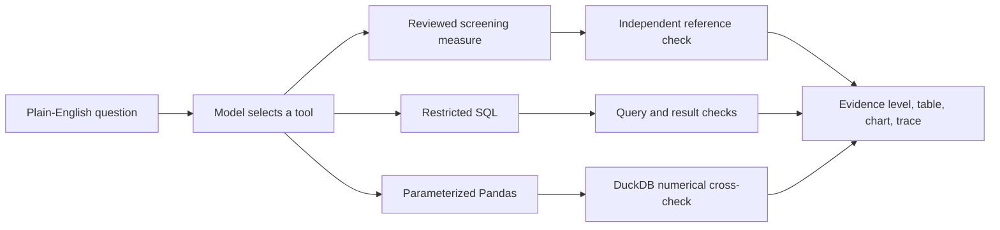

# CareInsight AI

**A natural-language analytics prototype for synthetic healthcare records.** Ask a plain-English data question; the model selects a reviewed screening measure, restricted SQL, or parameterized Pandas. One app displays the calculated table, chart when suitable, plan, evidence level, and analysis trace.

This is a portfolio prototype using **Synthea synthetic data**, not real patient records. Its exploratory answers are not clinical findings or validated population estimates.

**[Try the live app](https://careinsight-ai-cdcqgk3wyjhuapear6parn.streamlit.app/)** · [Source code](https://github.com/yc4959/CareInsight-AI)

**Current scope:** All rows from four source tables are packaged with approved columns. Independently checked single-year screening-record coverage is available for 2018, 2019, and 2020; the reviewed cross-year comparison covers 2019–2020. Other supported aggregate questions are labeled exploratory. **Full product vision and free-hosting limits:** see [Scope and roadmap](docs/scope_and_roadmap.md). The local 18-file download is about 539 MB; it is not all hosted or queryable in this version.

The [2000–2021 annual data audit](docs/annual_data_audit.md) shows event counts, months with records, and screening-code rows by year. It identifies the incomplete 2021 window and a large change in procedure volume around 2011–2012; neither observation is a validated clinical trend. Regenerate it with `CAREINSIGHT_USE_DEMO_DATA=1 python -m scripts.audit_years`.

## At a glance



**Stack:** Python 3.11, DeepSeek API, DuckDB, Pandas, Plotly, Streamlit, pytest. The current orchestration is in [`careinsight/open_analysis.py`](careinsight/open_analysis.py); the [architecture guide](docs/architecture.md) maps each active module to its role. This project uses an LLM to choose a constrained tool and plan an analysis; it does not execute model-written Python.

## Try it

- “Which procedure descriptions appeared most often in 2020? Show the top 10 by number of records.”
- “How did adult depression screening record coverage change between 2019 and 2020?”
- “How many adults had a depression screening record in 2018?”
- “In 2019, which procedure codes involved the most different patients? Show the top five codes.”
- “Which encounter types have the most substance use screening procedure records in 2020?”
- “2019 top five” is deliberately incomplete; the agent should clarify what to rank.
- “What were people getting checked for most often in 2020?” tested clarification about the type of record and whether to count records or people.

The app accepts open-text descriptive questions over the exposed data. It cannot answer every healthcare question. It should clarify ambiguous requests and decline unsupported causal, clinical, or patient-level requests.

## What happens after a question

1. The model interprets the request and selects a reviewed screening tool, **restricted aggregate SQL**, or **parameterized Pandas**.
2. For a reviewed 2018, 2019, or 2020 screening measure, code builds SQL from the selected measure, year, and grouping, then compares every count with an independent Pandas reference. The 2019–2020 comparison checks each annual cohort separately. Other generated SQL receives structural and arithmetic checks.
3. Pandas aggregations are recomputed in DuckDB using the same selected parameters. This checks the numbers, **not** whether the selected parameters match the user's intent.
4. The app shows a table, chart when suitable, source tables, tool parameters or SQL, and checks performed.

The exploratory tool uses `patients`, `encounters`, `procedures`, and `conditions`. Source columns are restricted in code. A query may count records or distinct patients; these are different measures. Condition descriptions include findings and social factors, so condition-record counts must not be presented as disease prevalence.

## One main app, two evidence levels

| Result shown in `app.py` | Purpose | Evidence level |
| --- | --- | --- |
| Independently checked screening result | A defined 2018, 2019, or 2020 adult depression or substance-use screening record measure, overall or by age group or GENDER; or a 2019–2020 comparison of separate annual cohorts. | SQL counts must match the independent reference for every group or year before publication. The model's choice of measure, grouping, and year is checked against the question. |
| Exploratory result | Other descriptive questions over approved synthetic tables, including procedure and encounter counts. | Query restrictions and result checks. Pandas counts also receive a cross-tool numerical check; arbitrary SQL meanings are not independently audited. |

Earlier interfaces are retained under `legacy/` for project history; `app.py` is the single main entry point.

The adult screening measures are **custom demonstration measures**, not official quality metrics. Their denominator, code lists, and time windows are documented in `docs/metric_definition.md`, `docs/substance_use_screening_metric.md`, and [`docs/annual_comparison.md`](docs/annual_comparison.md). The 2021 event files stop in November; a full-year 2021 comparison is not offered.

## Data and local setup

The repository includes four small gzip CSV files under `data/demo/`. They contain **all rows from those four source tables**, but only approved columns, from Synthea's public **1K sample CSV** under Previous Versions (2019–2021) on the [Synthea downloads page](https://synthetichealth.github.io/downloads.html). They contain synthetic records and no names or addresses. See `data/demo/README.md` for provenance and citation, and `data/demo/manifest.json` for row counts and file hashes. The packaged event files contain records through 2021; this does not make every historical year or partial year comparable.

The app uses the packaged data automatically. To regenerate them from the original download, extract the CSVs into `data/csv/` and run `python scripts/build_demo_data.py`. Original CSVs are excluded from Git. Set `CAREINSIGHT_USE_DEMO_DATA=1` to force the packaged copy when both are present. Patient and encounter IDs remain in the packaged files to support joins; the app restricts queries from returning individual identifiers.

Requires Python 3.11 or later. From the project directory:

```bash
python3 -m venv .venv
source .venv/bin/activate
python -m pip install -r requirements.txt
python -m streamlit run app.py
```

The main app requires `DEEPSEEK_API_KEY`, `DEEPSEEK_BASE_URL`, and `DEEPSEEK_MODEL` in the server environment. Keep keys out of source files and Git. The hosted app uses Streamlit Secrets so visitors do not supply their own key. The live app was verified with a 2020 substance-use screening comparison by GENDER: its SQL counts matched the independent reference (F 113/388; M 117/311).

## Deploy on Streamlit Community Cloud

After the project is published to GitHub, create a Community Cloud app using `app.py` as the entry point. Select Python 3.11 in Advanced settings to match the tested local environment. The repository's `requirements.txt` supplies Python dependencies and `data/demo/` supplies the synthetic demonstration data; the 539 MB original CSV download is not needed on the server.

The full local download has 18 CSV files, including one about 296 MB. GitHub's ordinary single-file limit is 100 MB, and Community Cloud's memory limits make loading the raw files unsuitable for this free demo. An inactive Community Cloud app may sleep and require a visitor to wake it. [Scope and roadmap](docs/scope_and_roadmap.md) distinguishes these hosting constraints from what analyses the data could eventually support.

Add these three **root-level** values in Community Cloud's Secrets settings, using the provider values that worked locally:

```toml
DEEPSEEK_API_KEY = "your-private-key"
DEEPSEEK_BASE_URL = "your-provider-base-url"
DEEPSEEK_MODEL = "your-model-id"
```

Do not commit a populated `secrets.toml` file. The app reads these values from environment variables; Streamlit exposes root-level secrets that way. The server owner pays for model calls. Verify both a reviewed screening question and an exploratory question on the hosted URL before sharing it as a live demo.

## Evaluation

[`evaluation/report.md`](evaluation/report.md) records the observed runs, failures, and corrections. The fixed cases include **8/8** in the post-fix regression, **4/4** wording and counting-unit cases, and **1/1** unavailable-year case: **13/13 single-turn fixed cases across three separate observed runs**, with eight executed analyses matching expected counts and five requests ending without analysis as expected. Two clarification follow-ups also passed in separate completed tests. These are **small fixed-case results**, not an overall accuracy or routing estimate. Earlier failures and evaluator corrections remain in the report. The latest full offline test run passed **49 tests**, including 18 independent annual SQL–Pandas comparisons; live model routing is checked separately.

Run local checks with:

```bash
python -m pytest tests -q
CAREINSIGHT_USE_DEMO_DATA=1 python -m pytest tests -q
python -m evaluation.open_benchmark --limit 8
python -m evaluation.open_multiturn_benchmark
```

The two benchmark commands call the configured model and consume API usage. The test suite checks code behavior locally. Do not quote a new pass rate until the new run has actually completed.

## Interpretation limits

- Missing screening documentation does not prove a screening was not performed.
- Counts from synthetic patients do not describe a real population.
- Descriptive differences do not establish statistical significance, causes, or intervention effects.
- A passed numerical cross-check does not prove that a free-form question was interpreted correctly.
- The SQL restrictions are for a local prototype; this is not a reviewed multi-user clinical data service.

The next portfolio milestones are a broader question evaluation and a short walkthrough video or GIF for visitors who encounter a sleeping app. A direct-LLM SQL baseline has not been run, so no comparative performance claim is made.
