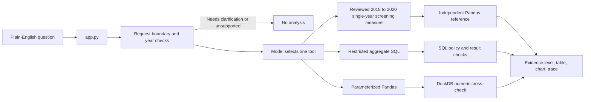

# CareInsight AI architecture

CareInsight AI is a local natural-language analytics prototype for **synthetic** Synthea records. The current entry point is `app.py`. It accepts descriptive questions, may ask for clarification, and shows the selected tool, analysis plan, results, chart when suitable, and an execution trace. Interface and reports are in English.

## Active components

| File | Responsibility |
| --- | --- |
| `app.py` | Single main Streamlit interface and evidence display. |
| `careinsight/open_analysis.py` | Question boundaries, model tool selection, at most two attempts, result validation, evidence classification. |
| `careinsight/model_client.py` | Model API request. The key stays in server environment variables. |
| `careinsight/verified_screening_sql.py` | Builds SQL for the reviewed adult screening record definitions. |
| `careinsight/summary_tool.py` | Independently calculates the reviewed annual screening counts in Pandas. |
| `careinsight/read_only_sql.py` | Restricts aggregate SQL to approved synthetic tables and columns. |
| `careinsight/pandas_aggregate.py` | Runs a fixed single-table aggregation from model-selected parameters and checks its counts in DuckDB. |
| `careinsight/data_source.py` | Uses original local CSVs when present, otherwise packaged `data/demo/*.csv.gz`. |

The reviewed path supports two **custom demonstration measures**, adult depression and substance-use screening record coverage in 2019 and 2020. Each annual measure can be shown overall, by age group, or by the source `GENDER` field. A 2019–2020 comparison computes separate annual cohorts and checks each year. The metric definitions are in `docs/metric_definition.md`, `docs/substance_use_screening_metric.md`, and `docs/annual_comparison.md`. A reviewed result is published only if every group count matches the independent reference. The 2021 event files stop in November and are excluded from full-year comparisons.

The exploratory path can address other descriptive aggregate questions over `patients`, `encounters`, `procedures`, and `conditions`. It can use model-generated restricted SQL for joins and more complex aggregations, or a parameterized Pandas operation for one-table counts. A Pandas result is numerically cross-checked using DuckDB with the **same selected parameters**. That check does not prove the selected parameters answer the user's question. Arbitrary SQL results receive policy, shape, and arithmetic checks but no independent semantic audit.

## Data and execution boundaries

- All records are synthetic. The packaged files are a small column subset of the public Synthea 1K sample; see `data/demo/README.md` and `manifest.json`.
- The model may choose a tool and its allowed parameters or write a restricted aggregate SQL query. It cannot submit arbitrary Python source to the Pandas tool.
- A deterministic request check declines causal questions. SQL restrictions block direct identifier output, and the fixed patient-ID disclosure test was declined. Ambiguous questions may receive clarification. These are prototype boundaries, not a clinical privacy certification or a guarantee for all wording.
- Missing screening documentation does not prove that screening was not performed. Condition descriptions are not a disease prevalence measure. Descriptive differences do not establish causes or statistical significance.
- `legacy/` holds previous UI versions. Other older `careinsight/agent*.py` and `careinsight/v2_*.py` files document earlier experiments; the current `app.py` does not import them.

## Evaluation

`tests/` checks deterministic tool and application behavior. `evaluation/report.md` records fixed-question smoke runs, prior failures, corrections, and their limits. Small benchmark pass counts describe only those observed cases, not overall agent accuracy. Run `python -m pytest tests -q` to check the code without making model calls.
